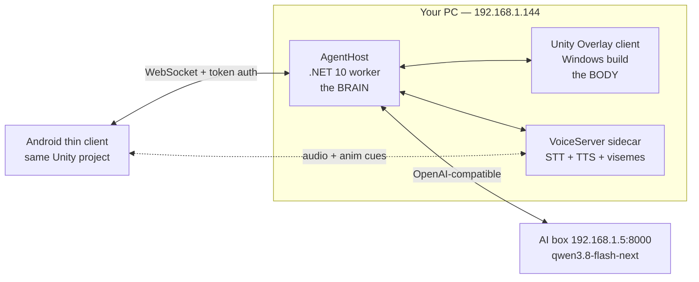

# AI Companion with a Body — Project Plan

**Working name:** *Mate* (change freely)
**Goal:** a 3D character that lives on your desktop (and your phone), talks out loud, and is driven by a real agent that can actually operate the PC and the internet.

**Reference point:** [Digital Mate on Steam](https://store.steampowered.com/app/2488350/Digital_Mate/) — I read the store page. It is a **desktop mascot**, not an agent: MMD model import, Steam Workshop models, hide/summon, "thoughtful reminders", and a "lightweight rendering engine" that sits over games/software/dynamic wallpapers. It has **no** PC-control brain.

> **So the honest framing:** you are building *Digital Mate's body* + *GitHub Copilot's brain*. The mascot part is a solved genre; the agentic part is where the real work is. Plan accordingly: **the agent is the product, the avatar is the face.**

---

## 0. What I verified on your machine (2026-09-23)

| Item | Value | Consequence |
|---|---|---|
| Unity editors installed | `6000.3.23f1`, `6000.6.0f1` | Unity 6 is already here. No install needed. Use **6000.3.x LTS** as the target, not 6000.6 (bleeding edge). |
| Unity CLI | `...\AppData\Local\Unity\bin\unity.exe` | I can drive the editor headless (recompile, tests, builds). |
| .NET SDK | `10.0.401` | The agent host can be a plain .NET 10 console/worker service. |
| GPU | RTX 2070 SUPER (8 GB) | Fine for rendering the avatar. **Not** enough to host a 27B LLM — but you don't need it to. |
| Node.js | **missing** | Avoid Node-based tooling unless we install it. |
| Godot | **missing** | Another point for Unity. |
| **AI box** | `http://192.168.1.5:8000/v1` — model `qwen3.8-flash-next`, `toolCalling: true`, `vision: true`, 250k in / 16k out | **This is the single best decision already made for you.** Tool-calling + vision + huge context = a real agent, no cloud bill. |
| AI box audio | `/v1/audio/speech` → **404**, `/v1/audio/transcriptions` → **404** | The box is **text-only today**. Speech-in and speech-out must come from somewhere else. This is the #1 gap in the whole project. |
| PC LAN address | `192.168.1.144` | Phone → PC target. See the security note in §7. |

**Verified third-party facts:** Piper-family offline TTS (ONNX/VITS) and Rhubarb-based Unity lip-syncers are both actively maintained (repos updated 2026). NVIDIA ACE is **not** on the table (licensing + no Android).

> ⚠ **Confidence caveat:** two research passes failed, so items marked *(verify)* below are from my prior knowledge, not freshly re-checked. They are all low-risk, but confirm before you buy anything.

---

## 1. The decision you were unsure about: one app or two?

**Neither. One codebase, three binaries.**



| Binary | What it is | Why separate |
|---|---|---|
| **`AgentHost`** | Headless .NET 10 worker. Owns the LLM loop, tools, memory, permissions, and the WebSocket hub. | Restarts independent of the avatar; unit-testable with no Unity; can run at boot; the phone talks to *this*, not to Unity. |
| **`Mate.Overlay`** | Unity **Windows Standalone** build. Transparent always-on-top click-through window showing the character over your other apps. | The presence layer. Can be killed/relaunched without interrupting a running agent task. |
| **`Mate.Mobile`** | Unity **Android** build from the **same project**. Mic capture, chat UI, renders the same avatar. | Your "phone is just a client that shows the avatar and lets me talk to it" — exactly right. |

**Why the brain must NOT live inside Unity** (this is the most important architectural call in the doc):
- You will iterate on agent behaviour *daily*. Iterating inside a Unity domain reload is slow and painful; a .NET project hot-restarts in ~1 s.
- The agent must keep working when the avatar window is closed, and survive avatar crashes.
- Tools (filesystem, shell, browser, UI-Automation) are plain .NET — zero reason to route them through `MonoBehaviour`s.
- The Android client then needs **no** tool code at all — smaller APK, no attack surface on the phone.

**Why one Unity project for both clients, not two:** identical avatar, animations, lip-sync driver, and protocol DTOs. Platform differences live behind `#if UNITY_ANDROID` / `#if UNITY_STANDALONEWINDOWS` and an `ITransport`/`IAudioSource` interface. Two projects = the avatar looks/behaves different on each platform within a month.

**Rejected alternatives, with reasons:**
- **Godot** — MIT licence is lovely, but no installed editor, weaker humanoid retargeting/Animator-layer tooling, and GDScript/C# split for the networking layer. Not worth it for a genre that lives or dies on animation quality.
- **Unreal** — best facial tech, but MetaHuman licensing + C++ build times + heavy mobile footprint for a *desktop pet*. Overkill.
- **Web (Three.js + Tauri/Electron)** — genuinely attractive for the *phone* (a WebView client is cheap), and worth keeping as a fallback if the Unity Android build fights you. But transparent click-through overlay windows are harder from Electron than from Unity + Win32 interop, and you'd own more of the animation stack. *(verify current Tauri transparent-window status if you want this route.)*
- **Live2D instead of FBX 3D** — Digital Mate uses MMD/Live2D-style models and it looks great. But you asked for FBX + animations, and a 3D humanoid gives you real screen-space positioning, camera work, and physical interactions. Keep Live2D as a *style option*, not the architecture.

---

## 2. The avatar (FBX, rig, animations)

**Pipeline:** FBX → **Unity Humanoid** rig → `Animator` Controller with layers → blendshapes for the face.

| Need | Recommendation | Notes |
|---|---|---|
| Base rigged character | Mixamo *or* an Asset Store humanoid pack *(verify Mixamo's 2026 availability + Adobe-account terms before relying on it)* | Anything Humanoid-compatible works; the rig type matters more than the source. (user can provide the model and animation ask him) |
| Animation library | Mixamo's animation set is the cheap way to get idle/walk/talk/think/nod/point/sit | Retargets onto any Humanoid for free.(again ask user he might have some assets of animations) |
| VRoid/VRM route | VRM is the VTuber-native format and the ecosystem is rich; needs a third-party importer *(verify a maintained VRM 1.0 importer — the Univr/VRM-CSharp lineage)* | Only take this route if you want the VTuber look + its free asset culture. |
| Facial expression | Blendshapes (visemes + emotion shapes), driven by a script, **not** by baked clips | Baked face clips fight lip-sync. |
| Gesture layering | `Animator` **Layer 1** = additive gesture layer with an **Avatar Mask** (upper body / arms only), so gestures play over the base idle without breaking the legs | This is the standard, cheap way to get "alive" behaviour. |
| Idle/speaking variety | A `GestureDirector` that picks weighted clips on timers + reacts to agent state | Do this by hand; don't buy a system first. |
| Motion Matching (Unity 6) | Skip for v1 | Nice for locomotion games, irrelevant for a desk pet. |

**Art direction call — make it now, it saves weeks:** a **stylised/chibi** character with a big expressive face is (a) far cheaper to rig and animate, (b) reads well at the small size a desktop pet occupies, (c) runs at 60 fps on a phone, and (d) forgives imperfect lip-sync. A realistic human is the hardest possible target and will expose every weakness in a first version.

**Budget the avatar as a purchase, not a task.** Expect to spend real money (Asset Store pack / commissioned model) rather than model it yourself.

---

## 3. Voice pipeline (the actual hard part)

Your box is text-only, so voice is a separate subsystem. Design it as **pluggable providers** so you can start free/offline and upgrade later.

### 3.1 Speech-to-text (hearing you)
| Option | Where | Offline | Verdict |
|---|---|---|---|
| **whisper.cpp / faster-whisper sidecar** on the PC or the box | PC/box | ✅ | **Default.** Runs on CPU/GPU, no per-call cost, no data leaves the LAN. |
| Add `/v1/audio/transcriptions` to the serving stack | box | ✅ | **Best long-term** — one endpoint for everything. Check whether your server (SGLang/vLLM lineage) exposes audio endpoints in its current version *(verify)*. |
| Azure / Google / Deepgram streaming | cloud | ❌ | Only if on-device accuracy disappoints. |
| Android `TextToSpeech`/`SpeechRecognizer` | phone | device-dependent | Avoid as primary — you said voice goes to the PC and that's correct: **ship raw PCM from the phone, transcribe centrally.** One STT to tune, not two. |

**Transport:** phone captures **PCM 16-bit, 16 kHz mono**, chunks it, streams over the existing WebSocket. No codec needed at LAN bandwidth.

### 3.2 Text-to-speech (its voice)
| Option | Offline | Visemes | Verdict |
|---|---|---|---|
| **Piper** (ONNX/VITS) | ✅ | ✅ phoneme timing | **Default.** Free, CPU-fast, and it hands you phoneme timings → free lip-sync. |
| **Kokoro** | ✅ | partial | Higher-quality upgrade path, same self-hosted shape. |
| **edge-tts** (`rany2/edge-tts`, 12k★) | ❌ | ❌ | **Best day-one demo voice:** free, genuinely good neural voices, no API key. But it calls Microsoft's **online** Edge read-aloud service — unofficial/unlicensed endpoint, needs internet, ships your text out, and gives no phoneme timings. Prototype only; never a shipping dependency. |
| Windows `System.Speech.Synthesis` | ✅ | ❌ | Windows-only → can't be the shared path. Fine as a debug fallback. |
| Android native TTS | ✅ | ❌ | Robotic; only a fallback. |
| ElevenLabs / Azure / OpenAI TTS | ❌ | varies | **Optional premium voice.** Azure gives phoneme/viseme events; ElevenLabs gives character timestamps. Keep behind the same `ITTSProvider` so it's a config flip. |

### 3.3 Lip-sync
- **Primary:** phoneme→viseme mapping from the TTS provider's own timing data. Zero extra latency, works identically on PC and Android, and is deterministic.
- **Secondary:** **Rhubarb** (offline audio analysis; maintained Unity integrations exist) for imported/pre-recorded clips where you have no phoneme data.
- **Also good:** [`hecomi/uLipSync`](https://github.com/hecomi/uLipSync) — 1.6k★, Burst/Job-System, VRM + WebGL aware. Best when you only have audio (no phoneme data) or want mic-driven mouth movement. Note it maps **A/E/I/O/U-style shapes**, not a full viseme set, so it's a fallback, not the primary path.
- **Skip:** NVIDIA ACE / Audio2Face (licensing + no Android), Oculus OVR LipSync (Meta-runtime coupling).
- **Reality check:** 8–10 viseme blendshapes + a good jaw/cheek set + blink + brow motion gets you 90 % of perceived life. Perfect visemes are not the bottleneck — *timing* is.

### 3.4 Latency budget (target, not promise)
`end of speech → end of reply audio` ≤ **1.5 s** on a good day. Achieved by: VAD-triggered streaming STT, **sentence-level streaming** (speak sentence 1 while the model writes sentence 2), and TTS prefetch. **Sentence-level streaming is the single highest-impact feature in the project** — it's what makes it feel alive rather than like a chatbot with a puppet.

---

## 4. The agent (the actual product)

### 4.1 Brain
Talk to `http://192.168.1.5:8000/v1` with an OpenAI-compatible client. Keep an `ILLMProvider` seam so cloud (Claude/GPT/Gemini) is a config change, not a refactor — useful for the cases where your local model is weak (long tool chains, tricky JSON).

> **Config hygiene (learned the hard way from a competing plan):** **every** host and port is
> config-driven — LLM base URL, voice sidecar host/port, and the WebSocket bind. Nothing hardcoded,
> and **do not reuse port 8000 for anything else**: your LLM already owns it on `192.168.1.5`. Give the
> sidecar something like `8790` and the hub `8791`. `localhost` as a default silently breaks the
> Android client, so the default must be a configurable host from day one.

> **Language choice — deliberately hybrid.** .NET 10 for the agent host, tools, and overlay interop
> (native Windows APIs, UI-Automation, Win32, and one language shared with Unity's C#). **Python only
> inside the voice sidecar**, where whisper/Piper/ONNX tooling is genuinely stronger. Note: Python is
> **not currently installed** on this machine (only the Microsoft Store stub), so that sidecar needs a
> real interpreter install before it can run.

### 4.2 Tool protocol: **MCP**
Use **Model Context Protocol** for tools rather than inventing your own. Reasons: a large ecosystem of ready-made servers already exists (filesystem, shell, browser automation, desktop control), so a big slice of "access to my PC" is *integration work, not construction work*; and you keep the option of using other people's tools forever. Official TS/Python SDKs exist; a C# path exists *(verify its maturity — if it's thin, speak MCP JSON-RPC yourself over stdio/HTTP; it's a small spec)*.

### 4.3 Tool set, in build order
| Tier | Tools | Risk | Gate |
|---|---|---|---|
| **T0 — safe** | read/list/search files in allowlisted roots, read clipboard, get time, web search, web fetch, open URL | low | none |
| **T1 — screen-aware** ⭐ | capture screen/region, **Windows UI-Automation** (read text under cursor / from the focused app), OCR fallback | low (read-only) | none |
| **T2 — writes** | write/edit files in allowlisted roots, create notes/tasks, organise folders | medium | allowlist + audit log |
| **T3 — actuation** | shell command, UI-Automation *invoke* (click/type), app launch, media control | **high** | **explicit per-call confirmation** |
| **T4 — never** | delete outside recycle, registry, firewall/AV, credential stores, `format`/`rd /s` patterns | — | hard-blocked |

⭐ **T1 is your "sit on some text" feature and it's the one to prototype first after the spike.** Windows UI-Automation gives you the *actual text* of the focused control — far more reliable than screenshotting and OCR-ing. Vision (`vision: true`) then becomes the fallback for things UIA can't see (canvas apps, games, images), with a screenshot of the region you're pointing at.

### 4.4 Memory
SQLite + a local embedding store. Conversation history, per-app context, "what I did" audit trail, and a small curated long-term memory. Embeddings: run locally *(verify an ONNX embedding model you're happy with)* — don't send your file tree to a cloud embedder.

### 4.5 Autonomy model
Three modes, switchable by voice/UI: **Ask** (propose, wait for yes) → **Confirm-on-write** (default) → **Full auto** (explicitly armed, with a visible on-screen indicator so you always know it's live). Plus a global **kill switch** (hotkey + phone button) that aborts the current tool call mid-flight.

---

## 5. Safety — read this before building T3

An agent that can run shell commands on your machine is the risky part of this project, and it's the part most hobby builds skip. Non-negotiables:

- **Every T3 call requires a user-visible confirmation** showing the *resolved* command (not the model's paraphrase of it).
- **Allowlist roots** for all file access; deny-by-default outside them. Watch for `..` traversal, symlink escapes, and short-path tricks.
- **Append-only audit log** of every tool call: timestamp, args, result, who approved it.
- **Run shell in a restricted token / separate process with a timeout and output cap** — never `Process.Start` with your full token and no timeout. *(Evaluate Windows Sandbox for anything exploratory.)*
- **Prompt-injection is a real threat here:** the agent reads web pages and your documents. Content from those must be treated as *data*, never as instructions. Tag all tool output as untrusted and instruct the model accordingly; never let fetched text trigger a T3 call without a human in the loop.
- **Bind the WebSocket to LAN-only by default**, require a pairing token, and prefer TLS. Note: your subnet is `192.168.1.x`, which is **not** in RFC1918 private space — so don't assume "it's just my LAN" is a security boundary. If the box/PC is reachable beyond your network, auth is mandatory, not optional.
- **Red-team it yourself** before you let it near anything you care about, and keep the kill switch honest.

---

## 6. Milestones (each has a pass/fail gate — don't skip forward)

| # | Deliverable | Gate | Rough effort |
|---|---|---|---|
| **M0** | **Overlay spike.** Transparent, always-on-top, **click-through**, non-GPU-hungry Unity window over real apps (browser, IDE, a game). Toggle click-through on/off. **Build on [`kirurobo/UniWindowController`](https://github.com/kirurobo/UniWindowController)** (MIT, 746★, active 2026, UPM-installable) rather than hand-rolling Win32 interop. | It sits over other apps, you can still click *through* it, and it doesn't cost you frames. | 1–3 days, **highest risk — do this first** |
| **M1** | **Talking puppet.** FBX → Humanoid → idle + talk clips, `Animator` layers + Avatar Mask, viseme blendshapes driven by a fake phoneme track. | Character visibly breathes, blinks, gestures, and mouths a canned line convincingly. | 3–7 days |
| **M2** | **AgentHost skeleton.** .NET worker → box, streaming tokens, tool-calling loop, T0 tools, SQLite audit log. | It answers questions and correctly calls a file-read tool. | 3–5 days |
| **M3** | **Wire them together.** WebSocket protocol, agent state → animation cues, **sentence-level streaming TTS**. | It reads you a long answer and starts speaking before the answer is finished. | 1 week |
| **M4** | **Voice in.** Mic → VAD → streaming STT → agent. Push-to-talk first, then hands-free wake word. | You talk, it replies out loud, reliably, in a noisy room. | 1–2 weeks |
| **M5** | **Screen awareness (T1).** UIA text extraction + screenshot + vision fallback. *"What does this say?"* pointing at anything. | It correctly reads text from your focused app without OCR when UIA can see it. | 1–2 weeks |
| **M6** | **Android thin client.** Same Unity project, Android build: mic → PCM → PC, avatar + TTS playback, chat UI, pairing flow. | Phone conversation feels as good as the desktop one. | 1–2 weeks |
| **M7** | **Actuation (T2/T3) + safety rails.** Confirmations, allowlists, audit UI, kill switch. | You can watch it refuse something dangerous. | 1–2 weeks |
| **M8** | **Polish.** Personality, memory recall, reminders (Digital-Mate-style), settings, boot-start, perf pass. | You leave it running all day voluntarily. | ongoing |

**Critical path:** `M0 → M1 → M2 → M3 → M4`. M5/M6 can run in parallel once M3 is stable.

> **M0 before anything else.** If transparent click-through overlay is a fight on your setup, the whole "sits on my desktop" premise changes, and you'd want to know that on day one — not after building the avatar.

> ⚠ **Known M0 gotchas, straight from the UniWindowController README — read before you start:**
> - **Transparency does NOT work in the Unity Editor.** You must **build and run** to test it. Do not conclude "it's broken" from Play mode. (Top-most and window moving do work in-editor.)
> - **Background transparency is not enabled with Direct3D12.** Target **D3D11** and disable *"Use DXGI flip model swapchain for D3D11"* in Player Settings.
> - **With URP:** Camera **HDR: Off** and **Alpha Processing: On**, or the alpha channel is destroyed and you get a solid/black background.
> - `TransparentType`: **Alpha** = pretty translucency, awkward touch input; **ColorKey** = natural touch but loses soft edges. Pick per-platform.
> - Multiple windows unsupported; touch support is explicitly "not yet determined"; the author calls it "not fully tested." Budget debugging time.
> - Same author ships a sample **VRM viewer** (`UniWinC_VRM`) — useful reference, and a hint that the VRM route plays well with this overlay approach.

---

## 7. Repo layout

Repo: `https://github.com/GamerPatrix/code-happiness.git` → local `C:\Users\patri\UnityProjects\code-happiness`
(default branch is `main`, not `master`). The Unity project gets created under `client/` at M0.

```
code-happiness/
  src/
    Mate.Core/            # shared DTOs, protocol messages, contracts (no Unity deps)
    Mate.AgentHost/       # .NET 10 worker: LLM loop, tools, memory, WS hub, permissions
    Mate.Tools*/          # one project per tool family (Files, Web, Screen, Shell, UIA)
    Mate.Voice/           # ILLMProvider / ISTTProvider / ITTSProvider / IVisemeSource + impls
  client/
    MateUnity/            # single Unity 6 (6000.3.x LTS) project
      Assets/Mate/Avatar/ # FBX, rig, Animator Controllers, Avatar Masks, blendshapes
      Assets/Mate/Runtime/# ITransport impls, LipSyncDriver, GestureDirector, overlay Win32 interop
      Assets/Mate/Platform/{StandaloneWindows,Android}/
    MateAndroid.slnx      # (Android build config / gradle templates if needed)
  server-sidecars/
    stt/                  # whisper.cpp / faster-whisper wrapper
    tts/                  # Piper / Kokoro wrapper
  docs/
  tests/                  # agent + tool unit tests, run headless — no Unity needed
```

**Protocol sketch** (`Mate.Core`, JSON over WSS):
`hello/pair` · `say{text,voiceId}` · `token{delta}` · `visemes[{t,viseme,weight}]` · `anim{cue,layer,weight}` · `tool.request{tier,name,args}` · `tool.decision{approve}` · `audio.chunk{seq,pcm16}` · `stt.partial/final` · `abort` · `state{idle|listening|thinking|speaking|needs-permission}`

---

## 8. Top risks

| Risk | Impact | Mitigation |
|---|---|---|
| Transparent click-through overlay is flaky (DWM, fullscreen games, DPI) | **Project-defining** | M0 spike first. Fallback: a normal docked window, or a Wallpaper-Engine-style integration, or Electron/Tauri shell. |
| Voice latency feels chatbot-y | Kills the illusion | Sentence-level streaming + TTS prefetch + VAD tuning. Measure from M3, not M8. |
| Local model is weak at long tool chains | Agent feels dumb | `ILLMProvider` seam → route planning-heavy turns to a cloud model; keep local for chat. |
| **Prompt injection via web/file content** | **Real security hole** | Untrusted-content tagging, human gate on all T3, audit log, hard-blocked T4. |
| Avatar quality is the ceiling on "wow" | Feels like a toy | Buy the model; go stylised; invest in blink/breath/gesture layering over lip-sync fidelity. |
| Scope creep (two platforms × agent × voice × avatar) | Never ships | Milestone gates. **PC-only until M5 passes.** Android is M6, not day one. |
| Phone mic quality / battery / background limits | Mobile feels bad | Push-to-talk first; foreground service + wake lock while listening. |

---

## 9. Open questions to settle before coding

1. **Character style** — user will provide
2. **Whose model** — user will provide
3. **Voice identity** — free offline Piper voice to start, and later we will figure something out
4. **Wake word** — push-to-talk first, hands-free wake word when it fully works
5. **How much autonomy on day one** — is T3 shell access even wanted early, or is read-only screen-aware assistance enough to prove the idea?
6. **Is the AI box always on**, and can it host the STT/TTS sidecars too (frees the PC's GPU entirely)?
7. **Do you want the phone to be "remote eyes"** later (phone camera → vision model)? Cheap, delightful, and it reuses all of M5.

---

## 10. What I'd do this week

1. **M0 overlay spike** — 3 evenings, decides everything.
2. **M1 talking puppet** with a placeholder cube-on-humanoid rig — proves the animation + viseme stack.
3. **M2 AgentHost** against your box — proves tool-calling works well enough on `qwen3.8-flash-next` to trust it with tools.
4. Then M3, and you'll have something you can actually talk to.

**The one-sentence summary:** build the **agent host first as a headless .NET service**, put the **avatar in one Unity project with two build targets**, keep **voice as pluggable providers** (Piper + whisper.cpp offline by default), use **MCP for tools**, gate every actuating tool behind a **confirmation**, and **spike the transparent overlay before you model anything**.
