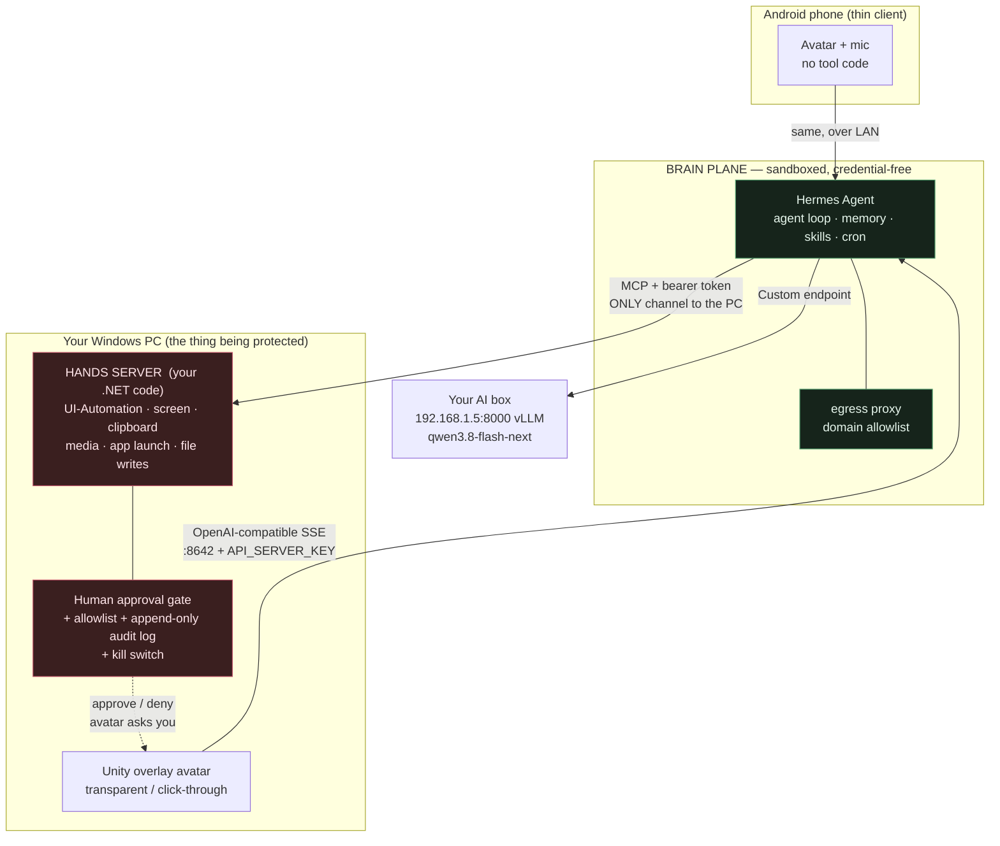

# Decision record: Hermes as the backbone, and how to sandbox it safely

**Your ask:** Hermes Agent as the backbone of the tooling, **but** it must not reach your email /
Google account, so it has to be sandboxed.

**Verdict up front: yes, Hermes is the right backbone** — it's a better fit for this project than the
Copilot SDK (see [DECISION-agent-runtime.md](./DECISION-agent-runtime.md)). But the *way* most people
sandbox it will not protect the thing you care about, and there is one specific feature in Hermes' own
docs that would silently defeat the sandbox entirely. Read §2 and §3 before you install anything.

---

## 1. Why Hermes is the right call (verified 2026-09-23)

`NousResearch/hermes-agent` — **248,334★**, **MIT**, Python, updated today, built by Nous Research.

| What the plan needed | Hermes already has it |
|---|---|
| Use **your** AI box, not a subscription | `hermes model` → **"Custom endpoint"** (saved in `config.yaml`), plus `OPENAI_BASE_URL`. Also has a **GitHub Copilot ACP** provider. No lock-in: *"Use any model you want… your own endpoint."* |
| A backend your Unity avatar can call | ⭐ **API server** = an **OpenAI-compatible HTTP endpoint** on `127.0.0.1:8642`, `POST /v1/chat/completions`, SSE streaming, `hermes.tool.progress` events so the avatar can *show what it's doing*. Gated by `API_SERVER_KEY` (min 8 chars). |
| Tools for "access my PC" | **MCP** with per-server `include:` whitelists, `/reload-mcp`, and `hermes mcp test <server>` returning exit `0/1/3` for health probes. |
| Interchangeable clients (PC + phone) | **ACP server mode** (`hermes acp`, stdio JSON-RPC) — renders chat, tool activity, diffs, **approval prompts**, streamed thinking. |
| Long-running companion memory | Self-improving skills, agent-curated memory, FTS5 cross-session search, Honcho user modelling. This is the "she remembers me" feature, free. |
| "Remembers to tell me things" | Built-in **cron scheduler** with natural-language schedules. |
| Runs on your box | **Native Windows** (PowerShell one-liner, no WSL needed) *and* Termux/Android. Installer brings its own `uv`, Python 3.11, Node, ripgrep, ffmpeg, portable Git Bash. |
| Don't trust it | **8-layer** security model: user authorisation, dangerous-command approval, file-write denylist, container isolation, MCP credential filtering, **prompt-injection scanning of context files**, cross-session isolation, working-dir allowlisting against shell injection. |

Their `approvals` config is exactly the gate my §5 wanted, and it fails **closed**: `mode: smart`,
`timeout: 300`, and `cron_mode` / `single_query_mode` / `unattended_mode` all default to **`deny`** —
so when nobody's there to approve, the dangerous command is *blocked* and the agent must find another
path. That is the correct default for an agent with hands on your PC.

**What Hermes does *not* give you:** the desktop-specific tools. No Windows UI-Automation, no
screen-region capture, no "read the text under my cursor", no media/volume control, no avatar
animation cues. Those are yours either way — **Hermes saves you the agent loop, memory, scheduler and
approval gate; it does not save you the product.**

---

## 2. The correction: a sandbox is not what keeps your email safe

You said *"I don't want it to have access to my email or Google account."* Think about what would
actually grant that access, because it isn't the absence of a container:

> **Credentials and logged-in sessions are the access. The container is only the blast radius.**

Three consequences:

1. **If Hermes holds no Google/OAuth tokens, it cannot read your mail — container or not.** Hermes has
   a *credential vault* and *credential pools*, and a plugin registry with comms/email plugins. The
   protection is **never putting those credentials in its data directory**, not the Docker boundary.
   Empty vault ⇒ structurally impossible, which beats "policy says don't".
2. **A container on the same PC you're protecting is a weak boundary for the half that matters.** The
   whole point of this app is that it acts on your desktop. Anything that can click "send" in your
   mail client is, by definition, not sandboxed away from your mail client.
3. **The real threat is prompt injection**, and Hermes' own docs agree — the network-isolation guide
   says it exists specifically as *"a defense against prompt injection attacks that attempt to
   exfiltrate data via `curl`, `wget`, or raw HTTP from tool-generated shell commands."* So the sandbox's
   genuine job is **egress control + file blast radius**, and that's what we'll use it for.

---

## 3. ⚠ The trap in Hermes' own docs — read this

The MCP guide contains a section titled **"WSL2: bridge Hermes in WSL to Windows Chrome"**, whose
stated purpose is:

> *"the browser you want to control is your normal signed-in Chrome on Windows"*

That feature is genuinely useful, and for **your** project it is a loaded gun. If Hermes drives your
everyday Chrome profile, then it has every Google session you have — **and the Docker container becomes
purely decorative**, because the agent's hands are reaching out of the container into your logged-in
browser. Same applies to Hermes' `browser_*` tools generally, and to any "web" skill.

**Non-negotiables for this project:**
- Hermes gets a **dedicated, logged-out browser profile** (fresh Chromium, no extensions, no profile
  sync, never your `User Data` dir). If it needs to see a logged-in page, *you* log in inside *its*
  profile, and that profile is disposable and rebuildable.
- **Never** wire it to your daily Chrome/Edge profile. Not now, not "just temporarily".
- Browser tools are **off by default** and armed per-session, same as T3 actuation.

---

## 4. The architecture that actually gives you what you asked for: two planes

Split the agent by **trust level**, not by feature. This is the single most important change from my
original §4.



### Brain plane — Hermes, disposable and credential-free
- Runs in **Docker** (or on the AI box — see §5). Contains: agent loop, memory, skills, cron, web.
- Holds **no** Google/OAuth/email credentials. Holds **no** browser profile you use.
- **Egress allowlist** so a hijacked `curl` can't phone home: allow your AI box `192.168.1.5:8000` and
  whatever search/LLM hosts you choose; **deny everything else**. Two Docker networks (`internal` with
  no route, `egress` through a `squid` proxy) is the documented pattern.
- Talks to the PC over **exactly one** channel: MCP to your hands server, with a bearer token.

### Hands plane — your own small .NET server, on the desktop
- The **only** thing that touches the desktop, and it's ~a few hundred lines of code you own and audit.
- Exposes the T0–T4 tools from §4.3 as an **MCP server** that Hermes consumes.
- **The approval gate lives here, outside the model's reach.** Hermes' `smart` approvals are a good
  first line; your gate is the real one, because the model cannot edit your code.
- Enforces: allowlisted roots, resolved-command confirmation (never the model's paraphrase), audit log,
  restricted token + timeout + output cap on shell, kill switch.

**Why this is better than "just Docker it":** the dangerous capability is small, local, reviewable and
yours; the big, prompt-injectable, third-party thing is the part with no hands and no keys. If Hermes is
fully compromised tomorrow, the worst case is an annoying stranger talking through your avatar.

> **One seam to keep:** wrap the whole thing behind `IAgentRuntime` so `HermesRuntime` (default) and a
> thin `DirectLlmRuntime` fallback both fit. Hermes is a fast-moving pre-1.0-ish Python project with
> 44k open issues; you want an exit hatch, not a hostage.

---

## 5. Where to run the brain — this is the decision I need from you

| Option | Security | Cost | Notes |
|---|---|---|---|
| **A. On the AI box (`192.168.1.5`)** ⭐ | **Best.** The agent is genuinely *off* your PC; every desktop action must cross the network through your audited hands server. | Needs Docker (or a venv) on that box; needs SSH access to set up. | If it's already running vLLM it's probably Linux and may already have Docker. **This is the version that makes "no access to my email" structurally true.** |
| **B. Docker Desktop on this PC** | Good for files/egress, weaker for desktop reach — the hands server is local either way. | Docker Desktop = admin install, WSL2, several GB, a permanent daemon, likely a reboot. | Fine, and genuinely useful for the voice sidecar too. But it's the *second*-best placement. |
| **C. Native Windows, no sandbox** | Weakest: no egress control, no file blast radius. | Zero setup. | Only acceptable for a first smoke test of "does it talk to my box at all". Not a place to leave it. |

Your machine is well specced for B if we go that way: **64 GB RAM**, hypervisor present, `wsl.exe`
present. **`docker` is not installed** (no Docker Desktop, no Podman).

---

## 6. Hermes hardening checklist

Verified from their docs; anything marked ⚠ I have **not** confirmed and you must check in the spike.

**Must be true before it gets any real capability:**
- [ ] Provider = **Custom endpoint** → `http://192.168.1.5:8000/v1`, model `qwen3.8-flash-next`. Confirm
      tool-calling actually works against vLLM's served model — a companion that can't reliably emit
      tool JSON is a chatbot with extra steps.
- [ ] `approvals.mode` **not** `approve`/`off`; `cron_mode: deny`, `single_query_mode: deny`,
      `unattended_mode: deny`. **Test it**: ask it to run something dangerous and confirm it blocks.
- [ ] API server bound to loopback (`API_SERVER_HOST` unset) unless the phone needs it; if exposed,
      `API_SERVER_KEY` ≥ 32 chars and TLS. ⚠ Do **not** set `API_SERVER_CORS_ORIGINS='*'` — their docs
      show it as an example, and `*` on a LAN is how you get driven by any webpage you visit.
- [ ] Credential vault **empty of** Google/OAuth/email tokens. No comms plugins (Telegram/Discord/
      WhatsApp/Signal) unless you want them — each is an inbound door.
- [ ] Browser tools disabled; dedicated disposable profile only (§3).
- [ ] MCP servers added with explicit `include:` whitelists — their own guidance: *"the server exposes a
      huge dangerous tool surface and you are not prepared to filter it"* ⇒ **don't** connect it.
- [ ] Egress allowlist enforced, and **verified by test**, not by hope:
      `docker compose exec hermes curl -sf --max-time 5 https://example.com` must **fail**.
- [ ] Use a **separate profile** (`user-guide/profiles`) for the companion so its memory/skills/creds
      can't bleed into any other Hermes you run.
- [ ] Append-only audit log of every hands-server call, written **outside** the container.

**⚠ Unverified, check during the spike:** exact key names for the file-write denylist and write
sandbox; MCP credential-filtering config; whether the API server streams tool events well enough to
drive avatar animation; whether Hermes runs cleanly with *zero* messaging platforms configured; native
Windows maturity vs WSL2 (their README says native is fully supported, but it's the newer path).

---

## 7. Install plan (once §5 is answered)

**If A (AI box):** SSH in → confirm Docker (`docker --version`) → run the official
`nousresearch/hermes-agent` image with a mounted `/opt/data` volume → `hermes setup` once to write
`~/.hermes/.env` → add the egress override → point the avatar at `http://192.168.1.5:8642/v1`.
Nothing new installed on your PC except the Unity client and the hands server.

**If B (this PC):**
```powershell
winget install -e --id Docker.DockerDesktop --accept-package-agreements --accept-package-terms-of-use
# then: WSL2 backend, start once, complete the first-run UI, likely reboot
docker --version
```
Docker Desktop is a system-wide install (admin, WSL2, a permanent background daemon, several GB). I've
held off on running it until you pick A or B — if the box can host it, your gaming machine doesn't need
the extra daemon and attack surface.

---

## 8. Also worth knowing (found while looking at `topic:ai-companion`)

**`moeru-ai/airi` — 49,351★, TypeScript, self-hosted, Windows/macOS/Web.** *"Re-creating Neuro-sama,
a soul container of AI waifu / virtual characters… realtime voice chat, Minecraft, Factorio playing."*
This is the closest existing thing to your *avatar* half, and it's far ahead of anything I'd have
planned for M0–M4. It is **not** a PC-agent (that's your contribution), and it's a big Vite/Vue/TS
codebase rather than Unity. Two honest options:
- **Study or fork AIRI** for the avatar/voice/lip-sync/live2D half, and put your hands server behind it.
  Fastest path to "it's on my screen and talking", but you inherit their stack.
- **Keep the Unity plan** (better for the transparent click-through overlay sitting over other apps,
  which is your distinctive feature and which a web-tech app struggles with), and **steal their
  voice/lip-sync/viseme approach** instead of reverse-engineering it from scratch.

My lean: **keep Unity for the overlay, but read AIRI's voice pipeline before writing yours.** Say the
word and I'll do that comparison properly.
